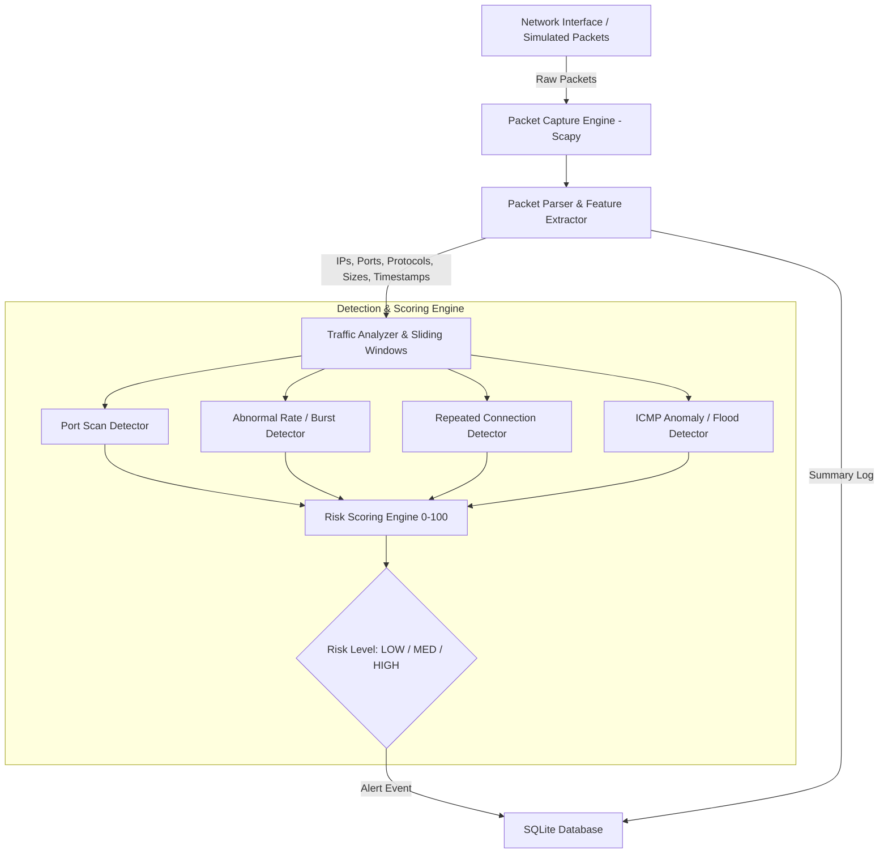

# Network Intrusion Detection System (NIDS)

A lightweight, Python-based Network Intrusion Detection System designed to monitor network traffic in real time, extract key packet headers, detect suspicious network activity using rule-based algorithms, compute quantitative risk scores, and persist security events in an SQLite database.

Based on the synopsis submitted for Bachelor of Computer Applications (BCA) at Graphic Era (Deemed to be University).

---

## 🏗️ Architecture & Dataflow



---

## 🛡️ Implemented Detection Rules

1. **Port Scan Detection (Chapter 5.2)**:
   * Tracks unique destination ports contacted by each source IP within a rolling time window (e.g. 10s).
   * Generates a **Port Scan** alert if the count exceeds the threshold.
2. **Abnormal Traffic / DoS Detection (Chapter 5.3)**:
   * Analyzes volumetric packet arrival rates per source host.
   * Generates an **Abnormal Traffic** alert when a burst exceeds normal operational limits.
3. **Repeated Connection Detection (Chapter 5.4)**:
   * Monitors repeated connection attempts (SYN requests / active handshakes) between host pairs.
   * Flags suspicious repetitive attempts.
4. **ICMP Traffic Anomaly Detection (Chapter 5.5)**:
   * Monitors ICMP echo requests for ping floods or reconnaissance ping sweeps.
5. **Risk Classification Engine (Chapter 5.6)**:
   * Evaluates packet rate, unique ports, and rule severity to generate a normalized score (0–100):
     * `0 – 30`: **LOW**
     * `31 – 70`: **MEDIUM**
     * `71 – 100`: **HIGH**

---

## 🗄️ Database Schema (`data/ids.db`)

* **`network_traffic`**:
  * `traffic_id`, `timestamp`, `source_ip`, `destination_ip`, `protocol`, `source_port`, `destination_port`, `packet_size`
* **`alerts`**:
  * `alert_id`, `timestamp`, `source_ip`, `destination_ip`, `attack_type`, `description`, `risk_level`, `status`

---

## 🚀 Getting Started

### 1. Prerequisites
* Python 3.9+
* Windows 10/11 or Linux
* For live packet capture on Windows: [Npcap](https://npcap.com/) (recommended with "WinPcap API-compatible Mode" enabled)

### 2. Installation
```bash
git clone https://github.com/prai-10/intrusion-detection-system.git
cd intrusion-detection-system
pip install -r requirements.txt
```

### 3. Running the Test Suite
Run the automated test suite to verify the packet parser, sliding window tracker, all 4 detection rules, and SQLite storage:
```bash
python tests/test_detection.py
```

---

## 📂 Project Structure

```plaintext
intrusion-detection-system/
│
├── config.py                 # Thresholds, capture interface, database paths
├── requirements.txt          # Dependencies (scapy, Flask)
├── .gitignore                # Git ignore rules
│
├── database/
│   ├── __init__.py
│   └── db_manager.py         # SQLite connection pool, schema & query helpers
│
├── core/
│   ├── __init__.py
│   ├── parser.py             # Scapy packet feature extractor
│   ├── analyzer.py           # In-memory sliding time windows & connection trackers
│   ├── rules.py              # Detection rules (Port Scan, DoS, Repeated, ICMP)
│   ├── risk_scorer.py        # Quantitative 0-100 risk scoring & level classification
│   └── capture.py            # Live sniffing & packet processing engine
│
└── tests/
    ├── __init__.py
    └── test_detection.py     # Comprehensive unit & integration tests
```
